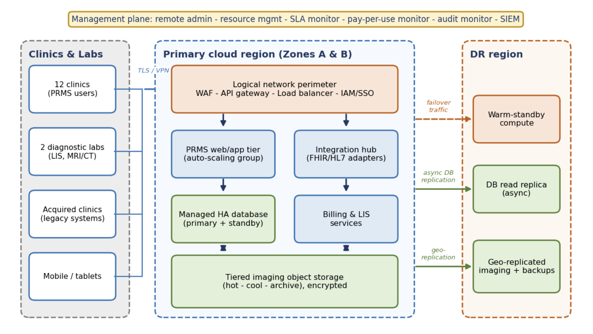
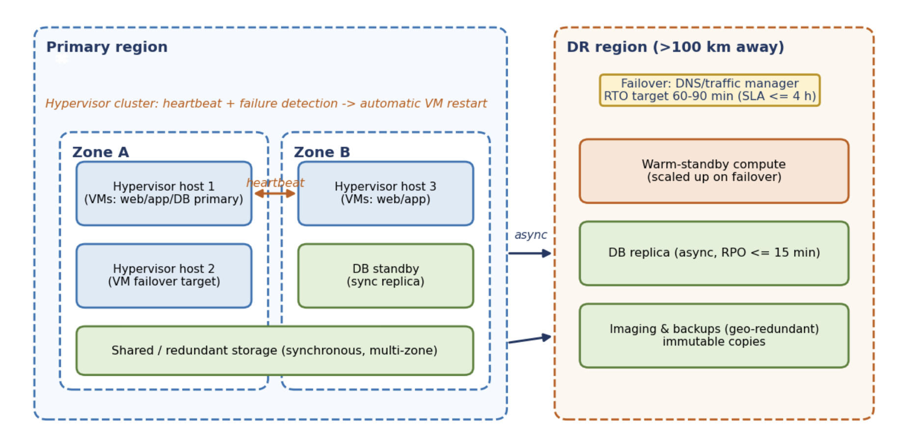
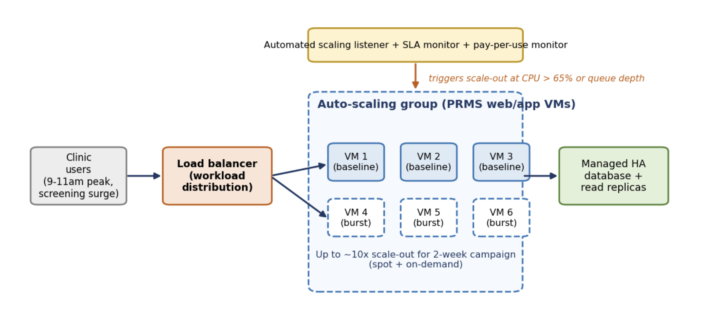
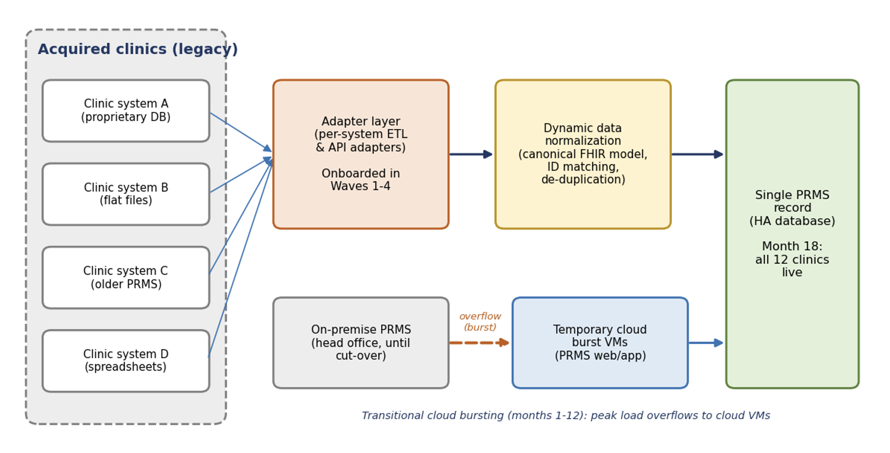
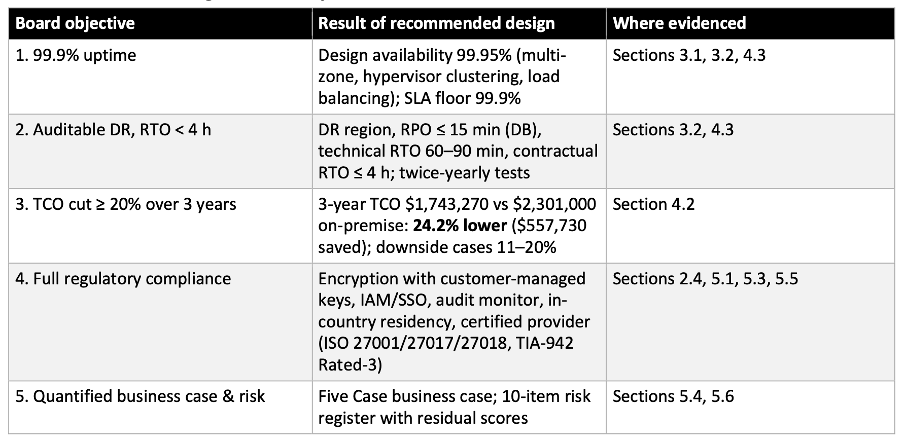
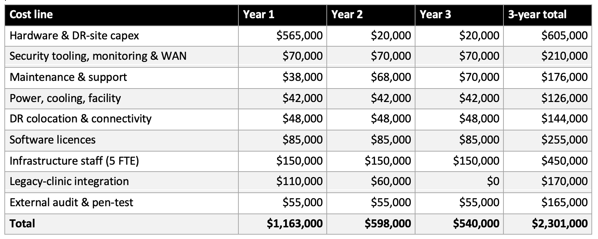
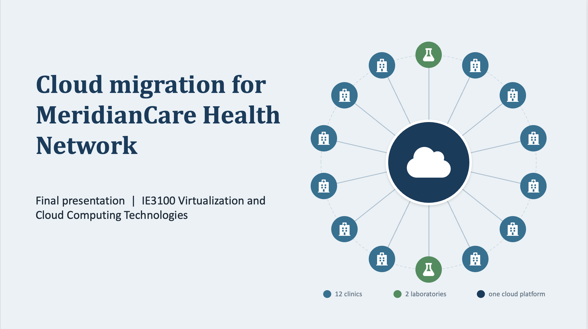

# ☁️ MeridianCare Health Network — Cloud Migration Consultancy

**Module:** IE3100 – Virtualization and Cloud Computing Technologies  
**Programme:** B.Sc. (Hons) in IT — Computer Systems & Network Engineering  
**Institution:** SLIIT | Year 3 – Semester 1

📄 **[Final Consultancy Report (PDF)](./meridiancare-cloud-migration/docs/Final_Consultancy_Report.pdf)** &nbsp;|&nbsp; 🎤 **[Final Presentation (PPTX)](./meridiancare-cloud-migration/docs/MeridianCare_Final_Presentation_finalize.pptx)**

---

## 📌 Overview

MeridianCare operates **12 clinics** and **2 diagnostic laboratories** on ageing on-premise servers with monthly DB failures, no DR site, and 9–11 am slowdowns. This project recommends a **phased public-cloud migration** with a multi-zone primary region and a secondary DR region.

**Board objectives:** 99.9% uptime · RTO < 4 h · ≥ 20% TCO cut · full compliance · quantified business case.

---

## ✅ Headline Results

| Objective | Outcome |
|---|---|
| 99.9% uptime | **99.95% design availability** (multi-zone, HA DB, load balancing) |
| RTO < 4 h | RPO ≤ 15 min · technical RTO 60–90 min · contractual ≤ 4 h |
| TCO cut ≥ 20% | **$1,743,270 vs $2,301,000** → **24.2% lower ($557,730 saved)** |
| Compliance | CMK encryption, IAM/SSO, audit monitor, in-country residency, ISO 27001/27017/27018, TIA-942 |
| Business case | HM Treasury Five Case Model + 10-item risk register |

---

## 🏗️ Solution at a Glance

- **Workload distribution** — load balancer + read replicas across two zones
- **Dynamic scalability** — auto-scale 6 → 40 servers for campaign spikes; spot for stateless workers
- **Tiered imaging storage** — hot / cool / archive with geo-replication
- **Hypervisor clustering + DR region** — sync standby in-zone, async replica >100 km away
- **Multi-device broker** — HTTPS/REST, HL7 v2, FHIR, DICOM
- **Dynamic data normalization** — FHIR canonical model + master-patient-index matching
- **Transitional cloud bursting** — on-prem overflow to cloud during migration

### High Availability & Disaster Recovery

### Elastic Scaling for Campaign Peaks

### Legacy Clinic Integration & Cloud Bursting

---

## 📊 Results Evidence

### Three-Year Cost Comparison

> On-premise: **$2,301,000** · Cloud: **$1,743,270** · **Saving: $557,730 (24.2%)**

### Four-Wave Migration Plan (18 months)
| Wave | Months | Scope |
|---|---|---|
| Pilot | 1–6 | Core PRMS, DB, imaging → cloud; Clinic A; DR built |
| Wave 2 | 5–10 | Clinic B; billing + LIS; peak-load test |
| Wave 3 | 9–14 | Clinic C; campaign scaling test |
| Wave 4 | 13–18 | Clinic D; decommission legacy; all 12 clinics live |

---

## 🎤 Presentation

Full deck available in the [`meridiancare-cloud-migration/docs/`](./meridiancare-cloud-migration/docs/) folder.

---

## 👥 Team

| IT Number | Name |
|---|---|
| IT24100816 | Jayasena W.M.S.A. |
| IT24103002 | Fernando C.J.S. |
| IT24102316 | Nihalsiri D.N. |
| IT24104361 | Mendis B.L.P. |

---

## 📚 Frameworks Referenced
NIST cloud mechanisms model · TIA-942 · ISO/IEC 27001/27017/27018 · HM Treasury Five Case Model · HL7 FHIR

---

*Academic project — IE3100, SLIIT.*
